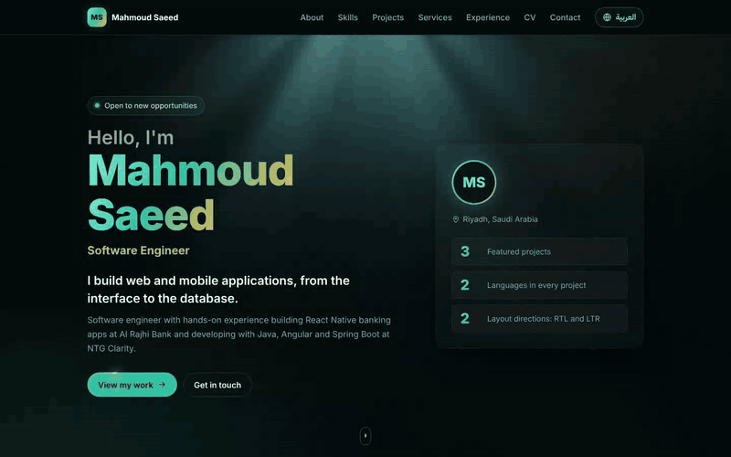
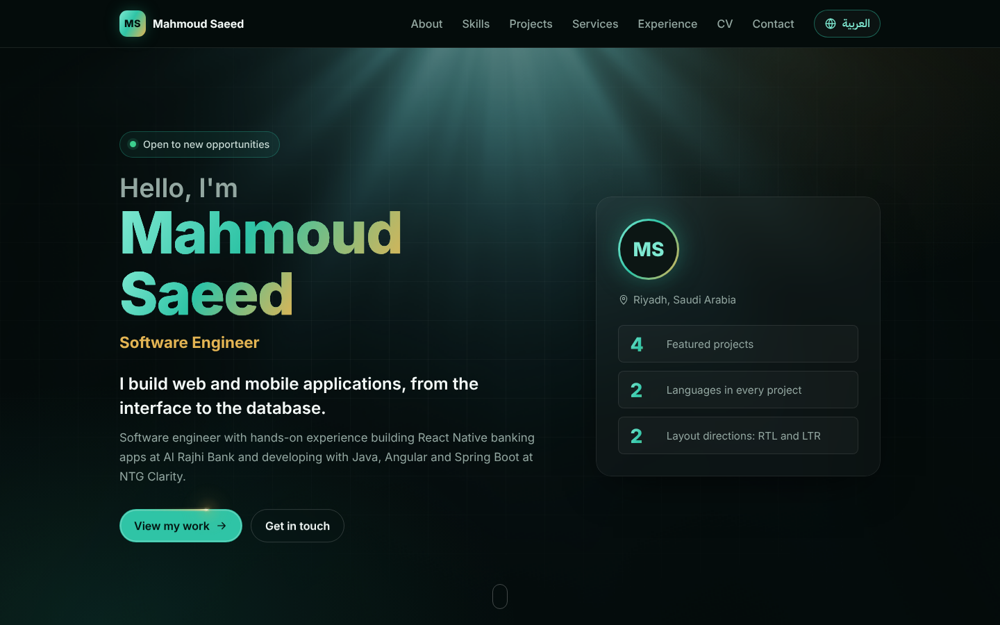
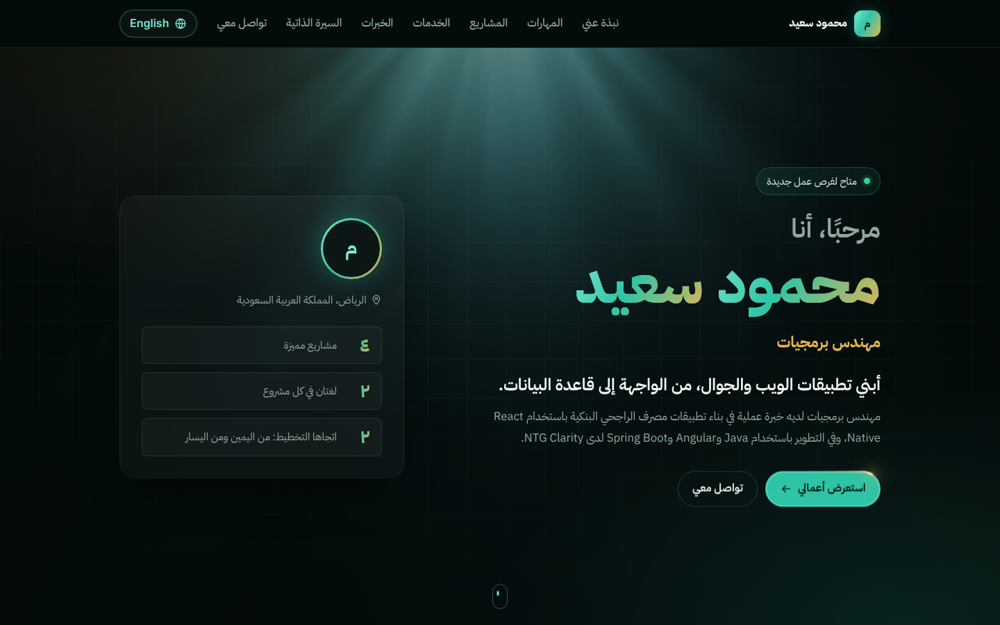
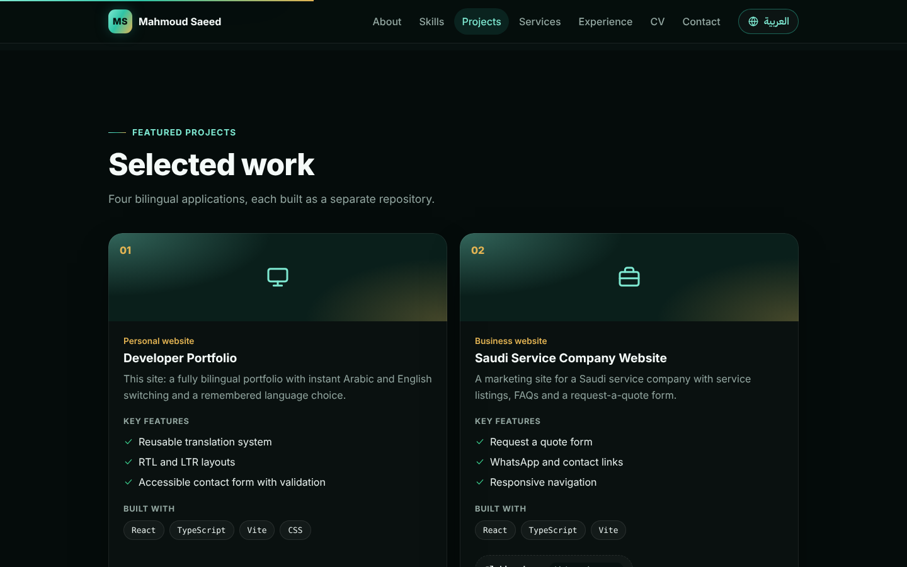
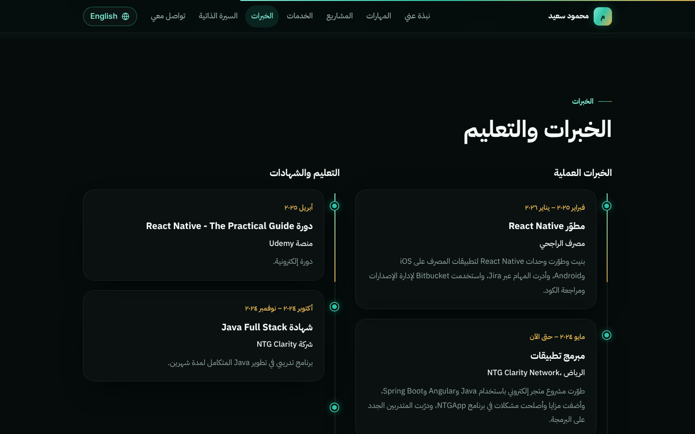
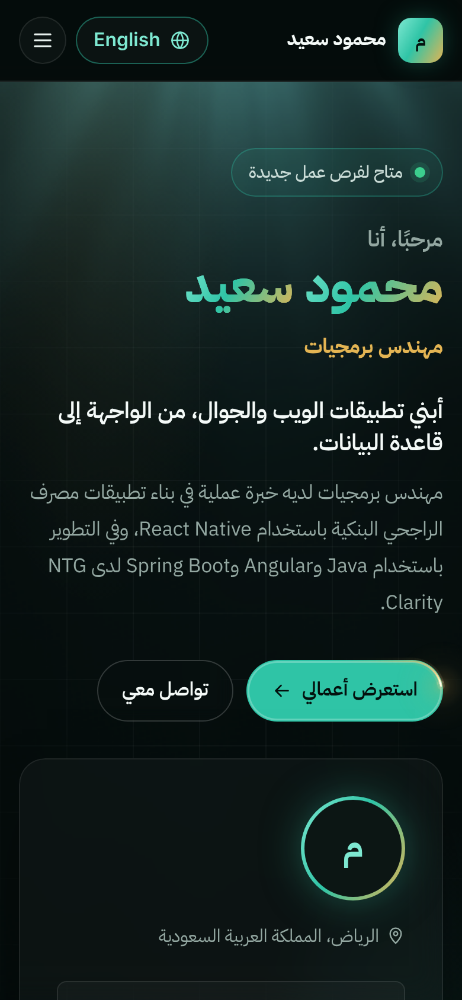
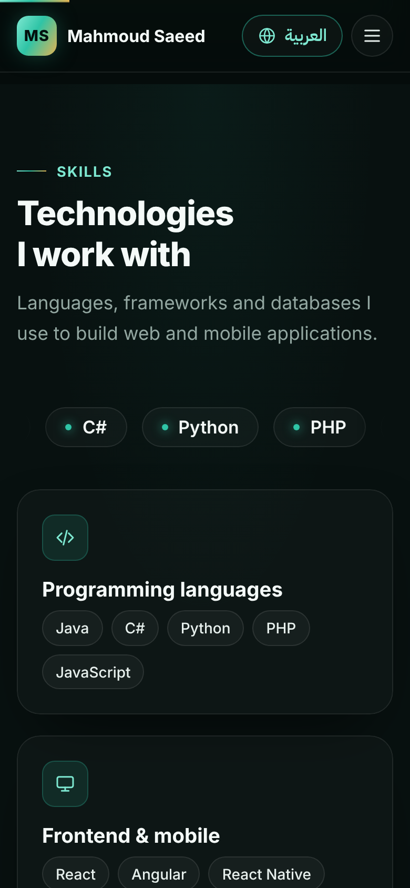
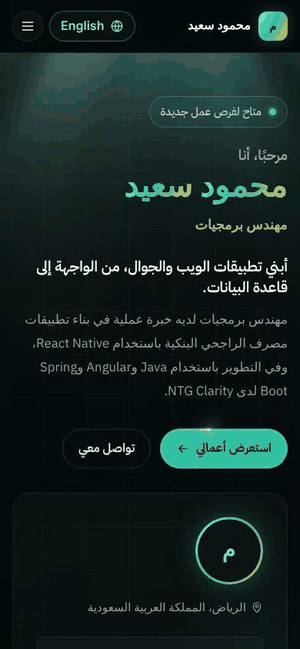
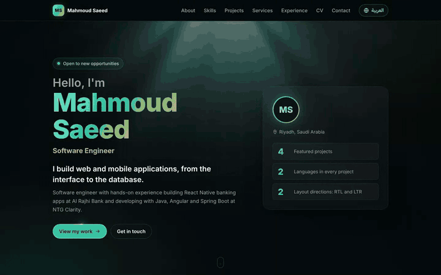

# Developer Portfolio · Arabic / English

**Live:** https://developer-portfolio-two-omega.vercel.app

Personal portfolio of **Mahmoud Saeed**, Software Engineer. One site in two languages: Arabic (right-to-left) and English (left-to-right), switched instantly with one button and remembered on the visitor's device.

Built with **React 19, TypeScript and Vite**, animated with **GSAP, Lenis and React Bits**.

<div dir="rtl">

موقع شخصي لعرض أعمال **محمود سعيد** (مهندس برمجيات)، بالعربي والإنجليزي. زر واحد يبدّل اللغة واتجاه الصفحة فورًا، والموقع يتذكر اختيار الزائر.

</div>



## Screenshots

| English (LTR) | Arabic (RTL) |
| --- | --- |
|  |  |
|  |  |

**Mobile**

| Arabic | English | Menu and navigation (Arabic) |
| --- | --- | --- |
|  |  |  |

**Scroll animations**



## What's inside

- **Sections:** Hero, About, Skills, Projects, Services, Experience, CV download, Contact.
- **Real bilingual layer:** one set of components, two typed dictionaries (`en.ts`, `ar.ts`). A missing Arabic key fails the build.
- **Proper RTL:** `<html lang dir>` switches with the language, layout uses CSS logical properties, arrows mirror, and Arabic visitors never see a left-to-right flash on load.
- **Locale formatting:** dates and numbers use `Intl` (`ar-SA` shows Arabic-Indic digits).
- **Contact form:** validation in both languages, errors re-translate on switch, typed text is kept. It opens the visitor's email app (`mailto:`); there is no fake backend.
- **Motion:** GSAP ScrollTrigger reveals, Lenis smooth scrolling, React Bits effects (light rays, blur text, spotlight cards, logo loop, click sparks). All of it turns off with `prefers-reduced-motion`.
- **Accessible:** skip link, keyboard menu (Escape closes), visible focus, labelled landmarks.

## Run it

Requires Node.js 20.19+ or 22.12+.

```bash
npm install
npm run dev        # http://localhost:5173
```

| Command | What it does |
| --- | --- |
| `npm run build` | Type-check and build to `dist/` |
| `npm run lint` | Lint with oxlint |
| `npm run test:e2e` | Playwright tests on desktop Chrome and a Pixel 7 (run `npx playwright install chromium` once) |

## Edit the content

| What | Where |
| --- | --- |
| Email, phone, social links, CV file, project links, experience dates | `src/config/profile.ts` |
| All text, in both languages | `src/i18n/locales/en.ts` and `ar.ts` |
| Colors and design tokens | top of `src/styles/global.css` |

Add a new string to `en.ts` first; `npm run typecheck` then fails until `ar.ts` has it too.

## Project structure

```
src/
  i18n/          language context, dictionaries, Intl helpers
  config/        profile data and links
  components/
    sections/    Hero, About, Skills, Projects, Services, Experience, Cv, Contact
    layout/      Header, LanguageSwitcher, Footer
    reactbits/   vendored React Bits effects
    ui/          Card, Icon, CountUp, toasts
  animation/     GSAP + Lenis setup and scroll reveals
tests/           Playwright end-to-end tests
```

## Deploy

Hosted on **Vercel**: every push to `main` redeploys automatically, and pull requests get a preview URL. GitHub Actions (`.github/workflows/ci.yml`) runs lint and build on every push. The build is static with relative paths, so Netlify, Cloudflare Pages or GitHub Pages also work.

## Credits

React Bits components are MIT + Commons Clause: free to use in this site, not to resell on their own.
